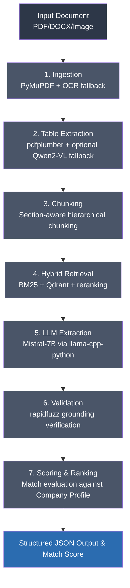

<h1 align="center">
  <span style="color: #2b6cb0">Tender</span><span style="color: #2d3748">ExtractPro</span>
</h1>

<p align="center">
  
  
  
  
</p>

A production-grade RAG pipeline for extracting technical specifications and scope of work from tender documents. Processes real PDF, DOCX, and image files through a 6-stage pipeline: ingestion, table extraction, chunking, hybrid retrieval, LLM extraction, and grounding validation. 

<span style="color: #e53e3e; font-weight: bold;">NEW:</span> Includes an LLM-powered <strong>Scoring and Ranking</strong> mechanism to evaluate the extracted tender against a customized Company Profile to determine match score and cost feasibility.

## Interface Overview

<div align="center">
  <p><strong>Upload & Processing</strong></p>
  
  <br><br>
  
  <p><strong>Extracted Specifications</strong></p>
  
  <br><br>

  <p><strong>Detailed Component View</strong></p>
  
  <br><br>

  <p><strong>Source Grounding & Evidence Match</strong></p>
  
  
  <br><br>

  <p><strong>Match Score & Ranking Analysis</strong></p>
  
  <br><br>

  <p><strong>Interactive Document Q&A with AI Assistant</strong></p>
  
  
</div>

## Architecture



## Quick Start

### 1. Setup Backend
```bash
# Setup environment (Windows)
python -m venv venv
venv\Scripts\activate
python -m pip install -r requirements.txt

# GPU extras (CUDA 12.6): see SETUP.md
# python -m pip install torch --index-url https://download.pytorch.org/whl/cu126
# python -m pip install paddlepaddle-gpu -i https://www.paddlepaddle.org.cn/packages/stable/cu126/

# Run the API server
uvicorn api.main:app --host 127.0.0.1 --port 8000 --reload
```

### 2. Setup Frontend
```bash
cd frontend
npm install
npm run dev
```

See [SETUP.md](SETUP.md) for detailed installation instructions including Tesseract, Poppler, and model download.

## GeM wrapper attachments

GeM bid wrappers are processed together with their linked specification PDF,
BOQ CSV and ATC document. Attachment discovery scans both PDF hyperlinks and
printed URLs, then classifies each official GeM HTTPS link by its label and URL
(`SpecificationDocument`, `BoqLineItemsDocument`, ATC/additional terms).
Repeated links are deduplicated, and URLs, hashes, retrieval times, wrapper page
references and the reason a download failed are recorded in an attachment
`bundle.json` next to the extraction output. Downloads use a browser User-Agent
because GeM's WAF rejects the default Python client with an HTML page.

When a wrapper links no BOQ at all, the unambiguous item/quantity list printed
in the wrapper (evaluation schedule or consignee tables) is used with page
citations. Manual upload is requested only when a referenced download is
blocked/rejected or the wrapper contains no usable link; the request lists the
affected role and reason.

Product attributes are extracted from the specification. BOQ descriptions,
quantities, units, and physical CSV row numbers are parsed directly from named
columns; wrapper text is used for bid conditions. Requirements carry a source
filename/page and a BOQ item association. Repeated headers do not remove evidence
from another page or CSV row. GeM bundles use role-separated full-text batches
rather than creating another tender vector index.

The BOQ must be a UTF-8 CSV with recognizable description, quantity, and unit
columns. Unknown formats, bad rows, inconsistent totals, missing files, unreadable
specifications, and unresolved item associations produce `tender_complete: false`.
Manufacturer matching, company-fit scoring, and product Q&A are blocked for these
results, including previously cached match reports. An HTTP 200 HTML rejection
page is not accepted as a specification or BOQ.

If GeM rejects the download, provide the two files locally:

```powershell
venv/Scripts/python.exe -m tender_extraction.main "wrapper.pdf" -o "outputs/tender.json" --specification "specification.pdf" --boq "items.csv"
```

Provided files are copied into the bundle cache with their hashes and
`acquisition: user_provided`; they are not represented as remotely verified
downloads. The web UI shows incompleteness and BOQ source rows. Existing non-GeM
documents keep the original pipeline.

## Cross-document reconciliation

`tender_extraction/reconcile.py` compares the specification, BOQ, and wrapper
before a manufacturer is scored. Comparison is rule-based: units are normalised
(`50 HP` ≈ `37 kW`), operators are honoured (`>= 37 kW` is satisfied by
`37 kW`), and the exact tolerance is explicit (2%). Statuses are `consistent`,
`conflict`, `refines`, `additional`, and `unmapped`.

Conflicts keep both original values and citations; the canonical value stays
unresolved until a human decides. Severity is requirement-driven: category,
quantity, and rating conflicts are critical and block matching. Wording
differences are flagged without blocking. A motor/pump without voltage or rated
power is a critical gap.

ATC clauses are extracted as `compliance_requirements`; turnover, experience,
MSE, and local-content conditions go to `vendor_eligibility`. Both stay separate
from the technical compatibility score. When a BOQ is referenced but cannot be
retrieved, the tender is marked incomplete and the wrapper is **not** silently
substituted; the wrapper item list is still shown for reference with its total.
When the tender references no BOQ at all, an unambiguous wrapper item/quantity
list is used as the item source with page citations.

Reconciliation output is stored under `reconciliation` in the result JSON, with
top-level `canonical_requirements`, `compliance_requirements`,
`vendor_eligibility`, `matching_blocked`, and `blocking_reasons`. The UI adds a
**Reconciliation** tab with the conflict table, source coverage, and blockers.

## Features

### Extracted Tender Elements
The pipeline produces a JSON file containing:
- **Technical Specifications**: Components, specs, and constraints.
- **Scope of Work**: Summaries, deliverables, exclusions, and locations.
- Every extracted value includes a source citation pointing back to the exact chunk and page in the original document.

### Match Scoring & Ranking
You can define a **Company Profile** (via the UI or `company_profile.json`) specifying capabilities, budget constraints, and operational exclusions. The pipeline evaluates the tender's requirements against this profile to output:
- **Match Score (0-100)**: Quantitative alignment score.
- **Cost Feasibility (High/Medium/Low)**: Budget match based on the company's financial capabilities.
- **Strategic Reasoning**: Paragraph outlining the reasoning and any potential red flags.

### Anti-Hallucination Safeguards
1. **Prompt Engineering**: The LLM prompt explicitly instructs "use NOT_FOUND for missing fields, NEVER invent values" and requires source citations.
2. **Grounding Verification**: After LLM extraction, every spec is fuzzy-matched against source chunks using `rapidfuzz`. Specs with grounding score below 0.40 are rejected.
3. **Pydantic Validation**: Output is validated against strict Pydantic v2 models.

## Advanced RAG Enhancements (Inspired by SimpleRAG)

1. **Semantic Chunking**
   - **Logic**: Replaced fixed-size splitting with `SemanticChunker` (from `langchain-experimental`). It identifies natural breakpoints based on embedding distances, ensuring that paragraphs are only split when the meaning changes.
   - **Optimization**: Implemented lazy-loading for the chunking embedding model to prevent high latency and memory churn during document processing.

2. **Parent-Child Retrieval**
   - **Logic**: Implemented a sophisticated indexing strategy. Small "child" spans (~200 words) are indexed in Qdrant for high-precision semantic matching, while the full "parent" chunks are returned to the LLM.
   - **Benefit**: This provides the LLM with much richer context than standard chunking while maintaining pinpoint accuracy during retrieval.

3. **Enhanced Extraction & Grounding**
   - **Prompts**: Refined system and user prompts to use professional "Tender Analyst" personas with strict verbatim extraction rules.
   - **JSON Repair**: Upgraded the JSON repair logic to handle common LLM failure modes like unescaped newlines and markdown fences more robustly.

4. **Environment & Stability Fixes**
    - **Virtual Environment**: Ensured all dependencies are correctly isolated in the project's local `venv`.
    - **LLM Fix**: Resolved the `PrefetchVirtualMemory` error on Windows by disabling `mmap` during model loading.
    - **Dependencies**: Updated `requirements.txt` to include the retrieval and multimodal runtime libraries used directly by the codebase.

5. **Optional Multimodal Table Recovery**
   - **Logic**: Conventional PDF extraction stays the default fast path for native tables.
   - **Fallback**: OCR-heavy or conventionally weak pages can be routed through an optional Qwen2-VL 2B table extractor when `MULTIMODAL_ENABLED=1`.
   - **Device-aware**: The vision model is released after table extraction so 8 GB-class GPUs can still run the Mistral text model afterward.

## Project Structure

```
TenderExtractPro/
  api/
    main.py             -- FastAPI server with extraction, Q&A, and scoring endpoints
  frontend/             -- React + Vite User Interface
  tender_extraction/
    config.py           -- Centralized configuration
    schemas.py          -- Pydantic v2 models for structured output
    scoring.py          -- LLM matching logic for company profile
    extraction.py       -- LLM-powered specification extraction
    vision.py           -- Optional Qwen2-VL-based table recovery for difficult pages
    main.py             -- Pipeline orchestration and CLI
  company_profile.json  -- Active company profile configurations
  dataset/              -- Real tender PDF files for testing
  models/               -- LLM model files (not in version control)
```

## Configuration

All tunable parameters are centralized in `tender_extraction/config.py`. Key settings:

| Parameter | Default | Description |
|---|---|---|
| `chunking.max_chunk_tokens` | 500 | Maximum tokens per text chunk |
| `retrieval.bm25_weight` | 0.35 | BM25 weight in score fusion |
| `retrieval.embedding_weight` | 0.65 | Embedding weight in score fusion |
| `llm.temperature` | 0.05 | LLM generation temperature |
| `validation.min_grounding_ratio` | 0.40 | Minimum grounding score to accept a spec |
| `multimodal.enabled` | `False` | Enable Qwen2-VL table fallback for difficult pages |

## Contributors

A big thank you to our contributors! 🙌

- **[Gaurav Varu](https://github.com/gauravvaru)** - Fix: Preserve filtered components in scoring logic ([#1](https://github.com/prathameshfuke/TenderExtractPro/pull/1))

See [CONTRIBUTORS.md](CONTRIBUTORS.md) for more details.

## Run locally (Windows)

```powershell
python -m venv venv
venv\Scripts\python.exe -m pip install -r requirements.txt
copy .env.example .env      # add GROQ_API_KEY
.\start.bat
```

`start.bat` now derives the project root from its own location (`%~dp0`), checks
that the venv has the backend dependencies, installs frontend packages on the
first run, and launches both servers. The API is at `http://localhost:8000`
(`/docs` for Swagger) and the UI at `http://localhost:5173`.

## Jobs, uploads and restarts

* Uploads are streamed to disk in 1 MiB blocks and rejected with `413` before
  the whole file is buffered. Unsupported types return `415`; empty files `400`.
* The job index is persisted to `outputs/jobs_state.json` and reloaded at
  startup. Jobs that were queued/running when the server stopped are marked
  `error` with an "interrupted" message instead of showing a frozen spinner.
* Deleting a job removes its upload, result, chunk cache and match report.
* `GET /health` reports API status, whether the matching engine is importable,
  and whether Redis is connected.
* `CORS_ORIGINS` (comma separated) controls allowed browser origins. It
  defaults to the Vite dev server and the Docker frontend on port 3000.

## Manufacturer matching API

The matching engine (Half A) produces a `MatchReport` as defined in
`tender_extraction/schemas_match.py`. The API consumes it through
`api/matching_adapter.py`, which expects:

```python
generate_match_report(tender_result: dict, *,
                      manufacturers_dir: str,
                      tender_file: str) -> dict  # or MatchReport
```

Endpoints:

| Method | Path | Description |
|---|---|---|
| `GET` | `/jobs/{id}/reconciliation` | Canonical requirements, conflicts, coverage, ATC compliance and vendor eligibility |
| `GET` | `/jobs/{id}/match` | Cached match report, or `{"error": "match report not generated"}` |
| `POST` | `/jobs/{id}/match` | Run matching now, persist `outputs/{id}_match.json`, update the job summary |

Matching is refused while a critical conflict is unresolved or a required source
is missing. The match report also carries `reconciliation`, separate
`technical_compliance`/`vendor_eligibility` lists, and `evidence_coverage`.

Set `MATCH_AUTORUN=1` to run matching automatically after extraction. The UI
adds a **Manufacturer Match** tab with a requirement x manufacturer matrix,
ranking cards, status filters and a page-level evidence drawer. The old
company-profile score remains under **Company Fit**.

The extraction metric is now labelled **Grounding** in the UI. The API exposes
it as `grounding_score` and keeps `accuracy_score` as a legacy alias.

## Manufacturer corpus

Catalogue data lives in `data/manufacturers/<slug>/` with a `sources.json`
provenance manifest (source URL, retrieval date, page count). See
[`data/manufacturers/README.md`](data/manufacturers/README.md) for the schema
and download commands. Validate it before running matches:

```powershell
python scripts\validate_manufacturer_corpus.py
```

Index the catalogues into category-scoped Qdrant collections (`cat_valves`,
`cat_pumps`, ... with manufacturer/subtype payloads, sha256 dedup):

```powershell
venv\Scripts\python.exe scripts\ingest_manufacturers.py
```

## Docker (backend + frontend + Redis)

Two images are produced: a CPU-only Python backend and an nginx-served
frontend that proxies `/api` to the backend. Redis caches match reports and QA
answers; the app runs fine without it.

```powershell
# 1. Configure
copy .env.example .env      # set GROQ_API_KEY

# 2. Build and run locally
docker compose up --build
# UI   http://localhost:3000
# API  http://localhost:8000/health

# 3. Publish both images to Docker Hub (public repos)
$env:DOCKERHUB_USER = "your-dockerhub-user"
docker compose build
docker compose push

# 4. Run the published images elsewhere
docker run --rm -p 8000:8000 --env-file .env `
  -v "${PWD}/outputs:/app/outputs" `
  -v "${PWD}/uploads:/app/uploads" `
  -v "${PWD}/data:/app/data" `
  your-dockerhub-user/tender-extract-backend:latest

docker run --rm -p 3000:80 your-dockerhub-user/tender-extract-frontend:latest
```

Notes:

* The compose file sets `REQUIRE_GPU=0`, `PADDLEOCR_DEVICE=cpu` and defaults to
  `BAAI/bge-m3` (CPU torch), so the demo runs on a laptop without CUDA.
* `HF_HOME` is a named volume (`hf-cache`), so the embedding model is only
  downloaded once.
* `outputs/`, `uploads/` and `data/` are bind mounts; job state and match
  reports survive `docker compose down`.
* For the nginx image the browser uses same-origin `/api`, so CORS does not
  apply. If you expose the backend directly, set `CORS_ORIGINS` accordingly.

## Tests

```powershell
venv\Scripts\python.exe -m pytest tests/test_api.py -q
venv\Scripts\python.exe -m pytest tests/test_pipeline.py -q
```

`tests/test_api.py` covers deterministic chunk IDs, streamed/oversize uploads,
job-state restart recovery, file cleanup on delete, the match-report contract,
the grounding-score alias and the no-Redis cache fallback. It does not call an
LLM or Qdrant.

## License

MIT
